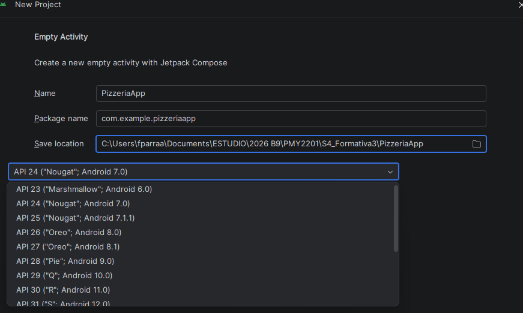
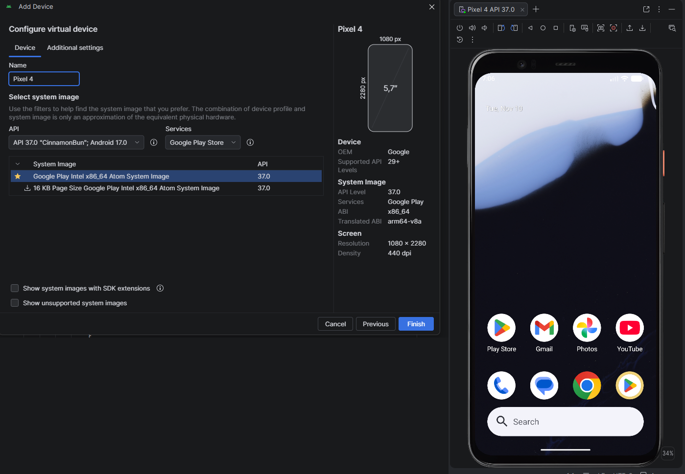
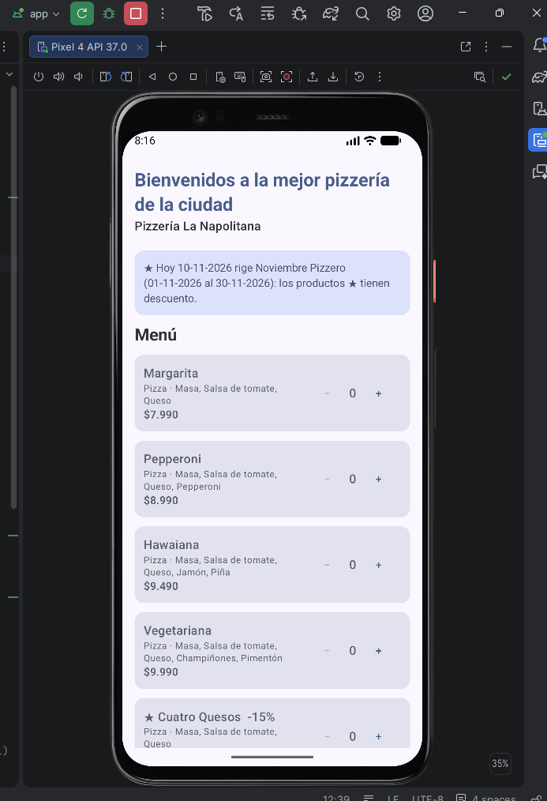
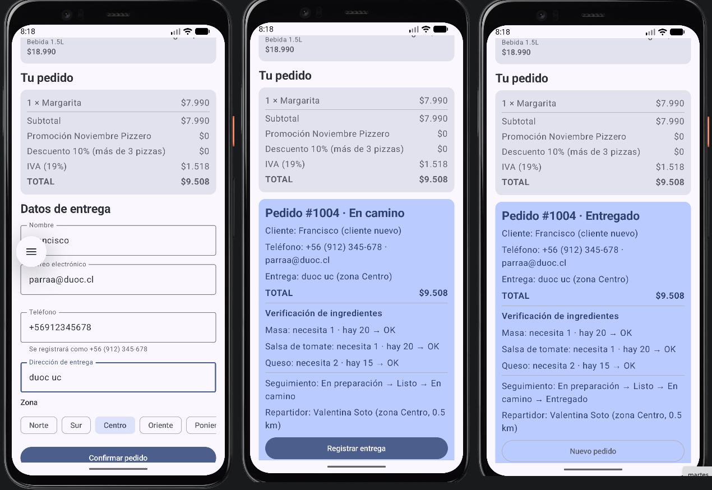

# PizzeriaApp – Configurando Android Studio

**Actividad:** Semana 4 · Actividad formativa · Desarrollo App Móviles I (PMY2201)

Proyecto Android creado en Android Studio con la plantilla *Empty Activity* (Jetpack Compose) y Kotlin. La lógica de la pizzería desarrollada en las semanas 1 a 3 se integró al proyecto organizada en paquetes. La pantalla principal muestra el mensaje **"Bienvenidos a la mejor pizzería de la ciudad"**, el menú, el cálculo del pedido y su despacho.

## Entorno

| Elemento | Versión |
|---|---|
| Android Studio | Rabbit 2 · 2026.2.2 Patch 1 (instalación Standard) |
| Android SDK | Platform 37 (Android 17), Build-Tools 36, Platform-Tools 37.0.1, Emulator 37.2.13 |
| Gradle / Android Gradle Plugin | 9.6.0 / 9.5.1 (Kotlin 2.2.10) |
| Proyecto | `PizzeriaApp`, paquete `com.example.pizzeriaapp`, `compileSdk`/`targetSdk` 37, **`minSdk` 23** |
| Dispositivo virtual (AVD) | Pixel 4 · imagen Google Play x86_64 API 37 · aceleración WHPX |

### Sobre el SDK mínimo (API 21 → API 23)

El asistente de Android Studio Rabbit 2 ya no ofrece API 21: la lista de *Minimum SDK* parte en API 23 (ver `evidencias/02_nuevo_proyecto.png`), porque las versiones actuales de Jetpack Compose y AndroidX exigen API 23 o superior. Si se fuerza `minSdk = 21`, el build falla al unir los manifiestos de esas librerías:

```
Manifest merger failed : uses-sdk:minSdkVersion 21 cannot be smaller than version 23
declared in library [androidx.compose.material:material-android:1.10.4]
```

 Por eso se eligió **API 23**, el mínimo disponible, que cumple con "API 21 (Android 5.0) o superior" de las instrucciones.

Como `java.time` (usado para las fechas del pedido y el periodo de la promoción) existe recién desde API 26, el proyecto activa *core library desugaring* para que funcione también en API 23 a 25.

## Cómo ejecutarlo

1. Android Studio → **Open** → carpeta del proyecto. Esperar el *Gradle sync*.
2. **Device Manager** → iniciar el AVD Pixel 4.
3. Elegir la configuración **app** y presionar **Run ▶**.

Pruebas unitarias (lógica de negocio, sin emulador): clic derecho sobre `app/src/test` → **Run 'Tests in pizzeriaapp'**, o en terminal `gradlew testDebugUnitTest`.

## Estructura

```
app/src/main/java/com/example/pizzeriaapp/
├── MainActivity.kt         Activity principal y función Greeting (mensaje de bienvenida)
├── modelo/                 Usuario, Cliente, Repartidor, Producto, Pizza, PizzaEspecial, Bebida,
│                           IngredienteExtra, Combo, Pedido, Inventario, Registro, estados y @Promocionable
├── servicio/               Pizzeria (reglas del negocio), ResultadoRegistro, ResultadoPedido
├── datos/                  DatosIniciales: catálogo, stock, repartidores, clientes y pedidos previos
├── utils/                  Validaciones (Regex), Calculos (rangos, descuentos, IVA), Reflexion, Formato
└── ui/                     PantallaPizzeria (Compose) y theme/ de la plantilla
app/src/main/res/values/strings.xml   texto de bienvenida (mensaje_bienvenida)
app/src/test/java/com/example/pizzeriaapp/   38 pruebas unitarias
```

## Integración de la lógica de semanas anteriores

| Semanas 1–3 (consola) | En Android |
|---|---|
| Paquetes `modelo`, `servicio`, `datos`, `utils` | Se mantienen sin cambios de lógica, ahora bajo `com.example.pizzeriaapp.*` |
| Capa `ui` de consola (`println`/`readLine`) | Reemplazada por `ui/PantallaPizzeria.kt` (Jetpack Compose); la consola no existe en Android |
| Menú numerado | Tarjetas por producto con botones − / + (cantidad dentro de 1..100) |
| Ingreso de cliente con Regex | Campos de texto que validan correo y teléfono mientras se escribe y muestran el teléfono formateado `+56 (XXX) XXX-XXX` |
| Cálculo del pedido | Resumen en vivo: subtotal, promoción `@Promocionable` (leída con reflection), descuento por volumen, IVA y total |
| Verificación de stock, despacho y entrega | Botón **Confirmar pedido**: stock todo o nada, asignación de repartidor por zona y distancia, seguimiento de estados y botón **Registrar entrega** |
| Formato de montos | `utils/Formato.kt`, separado de la presentación |
| Flujo del pedido en `main()` | `Pizzeria.confirmarPedido()` y `procesarPedido()`: la pantalla solo muestra resultados |

El texto de bienvenida está en `res/values/strings.xml` y lo muestra la función `Greeting` de `MainActivity.kt` (también visible en la vista previa `GreetingPreview`).

## Pruebas

38 pruebas unitarias con `kotlin.test` (JUnit 4): las 34 de la semana 3 adaptadas al nuevo paquete y 4 nuevas para el flujo `confirmarPedido` / `procesarPedido` (incluido reponer stock y reintentar) y para el formato de montos. Todas pasan con `gradlew testDebugUnitTest`.

## Evidencias

| Archivo | Muestra |
|---|---|
| `evidencias/01_android_studio.png` | Android Studio instalado (versión) y SDK Manager con plataforma, emulador y herramientas |
| `evidencias/02_nuevo_proyecto.png` | Asistente *Empty Activity*: nombre, paquete, ubicación, lista de SDK mínimo y `minSdk` del proyecto |
| `evidencias/03_avd.png` | AVD Pixel 4 creado en Device Manager y emulador en funcionamiento |
| `evidencias/04_app_bienvenida.png` | La app en el emulador con el mensaje de bienvenida |
| `evidencias/05_pedido.png` | Pedido confirmado en el emulador: totales, verificación de stock, repartidor y entrega |
| `evidencias/06_pruebas.png` | Resultado de las pruebas unitarias |







